# Entity-relationship diagram

The business entities the project tracks and how they relate. This is the logical view of the Gold galaxy schema in the [data model](data-model.md) (#138), with the agreed review changes noted below. Each entity maps to one Gold table (see [Entities](#entities)). Keep column names, allowed values, and NULL rules aligned with the data model as both are updated. The entities follow the team's alignment decisions in #45.

The team edits the diagram on [dbdiagram.io](https://dbdiagram.io/d/ReachED-ERD-6acf49c2aebfe7a21fe5f61c); [`erd.dbml`](erd.dbml) is a copy of its code. The diagram below is the same model in Mermaid so GitHub renders it. Change both in the same pull request, and keep them in step with the data model.

```mermaid
erDiagram
    city_municipality ||--o{ barangay : "city_mun_psgc_code"
    city_municipality ||--o{ enrollment_record : "city_mun_psgc_code"
    barangay ||--o{ enrollment_record : "barangay_psgc_code"
    school ||--o{ enrollment_record : "school_id"
    school ||--o{ classroom_record : "school_id"
    school ||--o{ personnel_record : "school_id"
    school_year ||--o{ enrollment_record : "school_year"
    school_year ||--o{ classroom_record : "school_year"
    school_year ||--o{ personnel_record : "school_year"
    education_level ||--o{ enrollment_record : "education_level_code"
    education_level ||--o{ personnel_record : "education_level_code"
    city_municipality ||--o{ population_record : "city_mun_psgc_code"
    city_municipality ||--o{ school_age_population_record : "city_mun_psgc_code"
    city_municipality ||--o| city_poverty : "city_mun_psgc_code"

    city_municipality {
        varchar city_mun_psgc_code PK "PSGC code or technical-member code"
        varchar city_mun_name "not null"
        varchar province_psgc_code
        varchar province_name
        varchar region_psgc_code
        varchar region_name
        varchar lgu_type
        varchar city_class "HUC/ICC/CC, NULL for a municipality"
        varchar income_class "1st-5th, NULL when not classified"
        boolean income_class_retained
        decimal land_area_sqkm
        varchar land_area_source
        boolean is_sga
        varchar member_type "not null, regular/unknown/excluded"
        varchar source_psgc_quarter
    }
    barangay {
        varchar barangay_psgc_code PK
        varchar barangay_name "not null"
        varchar city_mun_psgc_code FK "not null"
        varchar urban_rural "U/R"
        varchar member_type "not null, regular/unknown/excluded"
    }
    school {
        varchar school_id PK
        varchar school_name "not null"
    }
    school_year {
        varchar school_year PK "e.g. 2023-2024"
        integer start_year "not null"
        integer end_year "not null"
        boolean has_enrollment "not null"
        boolean has_facilities "not null"
        boolean has_personnel "not null"
    }
    education_level {
        varchar education_level_code PK "ES/JHS/SHS"
        varchar education_level_name "not null"
    }
    enrollment_record {
        varchar school_id PK, FK
        varchar school_year PK, FK
        varchar education_level_code PK, FK
        varchar city_mun_psgc_code FK "not null; real or technical member"
        varchar barangay_psgc_code FK "not null; real or technical member"
        varchar psgc_match_status "not null"
        varchar sector
        varchar annex_status
        boolean is_offered
        bigint learner_count "NULL only when all level counts are blank"
    }
    classroom_record {
        varchar school_id PK, FK
        varchar school_year PK, FK
        integer instructional_classrooms_total "NULL only when all three source counts are blank"
        integer temporary_learning_spaces
        integer classes_using_temporary_learning_spaces
        integer makeshift_rooms
        integer classes_using_makeshift_rooms
    }
    personnel_record {
        varchar school_id PK, FK
        varchar school_year PK, FK
        varchar education_level_code PK, FK
        integer teacher_count "D-047 teaching roles"
        integer sef_provincial_teacher_count "subset of teacher_count"
        integer sef_city_municipal_teacher_count "subset of teacher_count"
        integer lgu_funded_teacher_count "subset of teacher_count"
        integer other_funded_teacher_count "subset of teacher_count"
    }
    population_record {
        varchar city_mun_psgc_code PK, FK
        integer reference_year PK
        bigint population
        varchar estimate_status "not null"
        varchar status_reason
    }
    school_age_population_record {
        varchar city_mun_psgc_code PK, FK "provisional"
        integer reference_year PK "2020 or 2024"
        integer age PK "single year of age"
        varchar sex PK "male/female"
        bigint population
        varchar psgc_match_status "not null"
    }
    city_poverty {
        varchar city_mun_psgc_code PK, FK "one row per PSGC city/municipality"
        integer estimate_year "not null, 2023"
        decimal poverty_incidence "percent of persons; NULL unless estimated"
        decimal poverty_ci90_lower
        decimal poverty_ci90_upper
        decimal poverty_cv
        boolean poverty_cv_over_20 "NULL unless estimated"
        varchar estimate_status "not null"
        varchar status_reason "NULL when estimated"
    }
```

Every `enrollment_record` points to a city or municipality and a barangay, either a regular PSGC member or a technical member. This preserves records with unmatched, ambiguous, or excluded locations and allows joins to retain those records. Location and match status are stored per school year and are shared across the education-level records for that school-year combination.

## Entities

| Entity | Gold table | One row per | Key | Source or derivation |
|---|---|---|---|---|
| `city_municipality` | `dim_city_municipality` | City or municipality, plus technical members | `city_mun_psgc_code` | `psa_psgc` Silver ([D-035](../governance/decisions.md#d-035-psgc-silver)); land area from `hdx_boundaries` (D-042); members added in Integration |
| `barangay` | `dim_barangay` | Barangay, plus technical members | `barangay_psgc_code` | `psa_psgc` Silver (D-035); members added in Integration |
| `school` | `dim_school` | School | `school_id` | DepEd Silver |
| `school_year` | `dim_school_year` | School year | `school_year` | School years in DepEd Silver, with source-coverage indicators |
| `education_level` | `dim_education_level` | Reporting level | `education_level_code` | Reviewed list: ES, JHS, SHS ([D-047](../governance/decisions.md#d-047-question-v1-metric-counting-rules)) |
| `enrollment_record` | `fact_school_enrollment` | School, school year, and education level | `school_id`, `school_year`, `education_level_code` | `deped_enrollment` Silver; location from the Integration crosswalk ([D-029](../governance/decisions.md#d-029-one-set-of-match-columns-for-every-crosswalk), [D-031](../governance/decisions.md#d-031-special-geographic-area-schools-at-city-or-municipality-level), #91) |
| `classroom_record` | `fact_school_classroom_capacity` | School and school year | `school_id`, `school_year` | `deped_facilities` Silver ([D-038](../governance/decisions.md#d-038-deped-facilities-silver)) |
| `personnel_record` | `fact_school_teacher_capacity` | School, school year, and education level | `school_id`, `school_year`, `education_level_code` | `deped_personnel` Silver ([D-041](../governance/decisions.md#d-041-deped-personnel-silver)) |
| `population_record` | `fact_city_population` | City or municipality and reference year | `city_mun_psgc_code`, `reference_year` | PSGC's `2024 Population` column, `psa_psgc` Silver ([D-033](../governance/decisions.md#d-033-barangay-population-source)) |
| `school_age_population_record` | `fact_city_school_age_population` | City or municipality, reference year, single year of age, and sex | `city_mun_psgc_code`, `reference_year`, `age`, `sex` | **Provisional.** PSA Total Population by Single-Year Age, Sex, and City/Municipality, 2020 CPH and 2024 POPCEN ([source](../business/dataset-use-map.md#school-age-population-source)). Found, not yet profiled or ingested; requires name matching to PSGC using an approach consistent with [D-029](../governance/decisions.md#d-029-one-set-of-match-columns-for-every-crosswalk) |
| `city_poverty` | `dim_city_poverty` | PSGC city or municipality (2023), including those not in the PSA file | `city_mun_psgc_code` | `psa_poverty_stat` Silver ([D-034](../governance/decisions.md#d-034-psa-poverty-stat-silver-unpivot-to-one-row-per-unit-and-estimate-year)), following D-046 (#151) |

## Technical geography members

`member_type` is `regular` for a PSGC city, municipality, or barangay, and `unknown` or `excluded` for a technical member.

| An enrollment record whose… | Points to city / municipality | And barangay |
|---|---|---|
| City and barangay matched | The PSGC city or municipality | The PSGC barangay |
| City matched, barangay not | The PSGC city or municipality | That city's own `unknown` barangay, so it still rolls up to the city |
| City not matched (`unmatched` or `ambiguous`) | The global `unknown` city or municipality | The `unknown` barangay under it |
| Place is a Special Geographic Area ([D-031](../governance/decisions.md#d-031-special-geographic-area-schools-at-city-or-municipality-level)) | The `excluded` city or municipality | The `excluded` barangay under it |

`psgc_match_status` preserves the location-match outcome in every case; using a technical member does not erase it.

## Definitions

- **Education levels** ([D-047](../governance/decisions.md#d-047-question-v1-metric-counting-rules)): ES is Kindergarten, Grades 1–6, and ES non-graded; JHS is Grades 7–10 and JHS non-graded; SHS is Grades 11–12. `education_level_code` holds only these three values, never individual grades or strands.
- **`learner_count`**: the sum of the level's grade and non-graded counts that are not blank. NULL only when all of them are blank; NULL is never read as zero ([D-023](../governance/decisions.md#d-023-silver-never-invents-a-value)). `is_offered` indicates whether the school offers the level, distinguishing a level not offered from a missing count.
- **`instructional_classrooms_total`**: the sum of the ES, JHS, and SHS instructional-room counts that are not blank. NULL only when all three are blank. The temporary-space and makeshift measures are retained separately and never substituted into this total.
- **`teacher_count`**: Teacher I–III, Master Teacher I–IV, Head Teacher I–VI, SPED/SNED teachers, Special Science teachers, Instructors, and locally funded teachers, counted by level (Kindergarten locally funded teachers under ES). Principals and non-teaching staff are excluded (D-047). The four funding columns are subsets of `teacher_count` and must never be added to it again.
- **School-age population `sex`**: `male` or `female`. The PSA workbooks also contain a both-sexes total, which is not stored, so summing by sex does not double-count children. Analytics sums both sexes and ages 5–17 for AP4.
- **Population `estimate_status`**: `available`, `missing`, `provisional`, or `excluded`, with `status_reason` explaining why a value is not available (for example, City of Isabela's `#N/A` in PSGC, profile O-4).
- **Poverty** (D-046): one 2023 row for every PSGC city or municipality (1,642), including the 44 that are not in the PSA file. `estimate_status` is `estimated`, `no_estimate`, or `not_in_source`. When no estimate is available, `poverty_incidence`, confidence intervals, CV, and `poverty_cv_over_20` remain NULL rather than being set to zero. `status_reason` explains why no estimate is available and is NULL when estimated. The CV flag identifies estimates with a coefficient of variation above 20, which should be presented as less precise. Poverty is contextual information only; it is not used to rank, flag, or score locations. Technical geography members have no poverty row.

## Modeling assumptions

- **Location is stored per school year.** A school's city or municipality can change between school years, and AP4 compares years, so location and `psgc_match_status` are stored on `enrollment_record`, not on `school`. They are the same for every education-level record for a school in a given school year. DepEd's published place names remain in the Integration crosswalk ([D-029](../governance/decisions.md#d-029-one-set-of-match-columns-for-every-crosswalk)), not in Gold.
- **DepEd has no PSGC code.** Geographic codes come from the Integration crosswalk (#91).
- **Population is at city/municipality level**, because AP1 ranks cities and municipalities.
- **School-sector filters are applied in Analytics.** AP1–AP3 use public schools; AP4 uses all sectors except PSO (D-047). The sector is retained in enrollment records. Annexes count as schools and are labelled using `annex_status`.
- **Every PSGC city or municipality has a poverty row; technical members do not**, so the relationship is optional on the poverty side (`||--o|` in the Mermaid). DBML's `-` marks the link as one-to-one but cannot mark a side as optional, so the Mermaid shows the full cardinality.

## Resolved questions

Answered from the team's decisions (#45):

1. **Year alignment.** Gold has a school-year dimension (`school_year`). PSA tables retain their own reference years, and pairing is done in Analytics: D-027 for poverty, and the two census points for AP4 (2020 with SY 2020–21 and 2024 with SY 2024–25).
2. **School-age population.** AP4 uses ages 5–17 at city/municipality level from the PSA 2020 and 2024 tables. This source remains provisional until it is profiled and ingested.
3. **Missing counts.** Missing learner, classroom, and teacher counts remain missing, never zero ([D-023](../governance/decisions.md#d-023-silver-never-invents-a-value)).