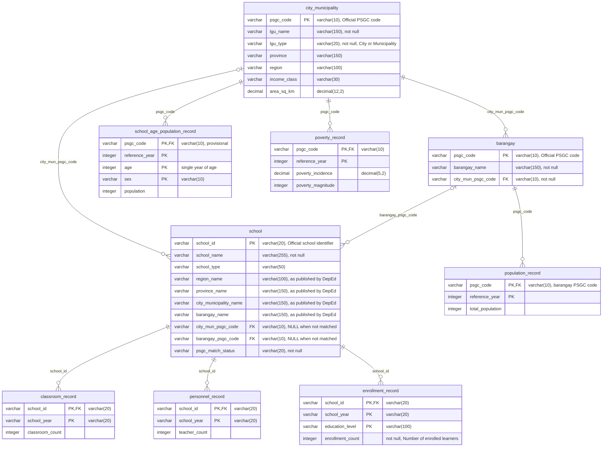

# Entity-relationship diagram

The business entities the project tracks and how they relate. This is a logical view, not the Gold table layout: Gold is a galaxy schema, documented separately in the [data model](data-model.md).

The team edits the diagram on [dbdiagram.io](https://dbdiagram.io/d/ReachED-ERD-6acf49c2aebfe7a21fe5f61c); [`erd.dbml`](erd.dbml) is a copy of its code. The diagram below is the same model in Mermaid so GitHub renders it. Change both in the same pull request.

`|o--o{` marks an optional link: a school may have no matched city, municipality, or barangay.

## Entities

| Entity | One row per | Key | Source or derivation |
|---|---|---|---|
| `city_municipality` | city or municipality | `psgc_code` | `psa_psgc` Silver ([D-035](../governance/decisions.md#d-035-psgc-silver)) |
| `barangay` | barangay | `psgc_code` | `psa_psgc` Silver ([D-035](../governance/decisions.md#d-035-psgc-silver)) |
| `school` | school | `school_id` | DepEd Silver; PSGC codes and `psgc_match_status` from the Integration crosswalk ([D-029](../governance/decisions.md#d-029-one-set-of-match-columns-for-every-crosswalk), [D-031](../governance/decisions.md#d-031-special-geographic-area-schools-at-city-or-municipality-level)) |
| `classroom_record` | school and school year | `school_id`, `school_year` | `deped_facilities` Silver ([D-038](../governance/decisions.md#d-038-deped-facilities-silver)) |
| `personnel_record` | school and school year | `school_id`, `school_year` | `deped_personnel` Silver ([D-041](../governance/decisions.md#d-041-deped-personnel-silver)) |
| `enrollment_record` | school, school year, and education level | `school_id`, `school_year`, `education_level` | `deped_enrollment` Silver |
| `population_record` | barangay and reference year | `psgc_code`, `reference_year` | PSGC's `2024 Population` column, `psa_psgc` Silver ([D-033](../governance/decisions.md#d-033-barangay-population-source)) |
| `school_age_population_record` | city or municipality, reference year, single year of age, and sex | `psgc_code`, `reference_year`, `age`, `sex` | **Provisional.** 2024 school-age population by single year of age, sex, and city/municipality; source found, not yet profiled |
| `poverty_record` | city or municipality and reference year | `psgc_code`, `reference_year` | `psa_poverty_stat` Silver ([D-034](../governance/decisions.md#d-034-psa-poverty-stat-silver-unpivot-to-one-row-per-unit-and-estimate-year)) |

## Modeling assumptions

- **DepEd has no PSGC code.** A school's `city_mun_psgc_code` and `barangay_psgc_code` come from matching its place names inside their parents in Integration ([D-029](../governance/decisions.md#d-029-one-set-of-match-columns-for-every-crosswalk)). Either may be NULL, and a school can match its city or municipality but not its barangay.
- **Unmatched schools are kept.** A school with `psgc_match_status` of `unmatched`, `ambiguous`, or `excluded` stays in `school` and in school-level results; only area-level results leave it out, and say how many ([D-031](../governance/decisions.md#d-031-special-geographic-area-schools-at-city-or-municipality-level)). The raw DepEd place names stay on the row so a reviewer can see why.
- **Population is barangay level.** City and municipality totals are sums of their barangays.
- **Not every area has a poverty estimate** ([D-028](../governance/decisions.md#d-028-cities-and-municipalities-without-a-poverty-estimate)), so joins from `city_municipality` to `poverty_record` are left joins.

## Open questions

These do not block the diagram; each is answered here or recorded as a decision before the Gold schema in the [data model](data-model.md) is finalized.

1. **Year alignment.** School tables use `school_year` (text, for example `2023-2024`); PSA tables use `reference_year` (integer). [D-027](../governance/decisions.md#d-027-poverty-2023-beside-sy-2023-24) pairs poverty 2023 with SY 2023-24. Is that rule a join in the dashboard, or a shared year dimension in Gold?
2. **School-age population.** After profiling: confirm the grain, whether the file carries PSGC codes or only names (names go through the Integration crosswalk), and which ages count as school age for each `education_level`.
3. **Nullable counts.** `classroom_count` and `teacher_count` may be null (Silver never invents a value, [D-023](../governance/decisions.md#d-023-silver-never-invents-a-value)). Confirm the dashboard shows these as missing, not zero.