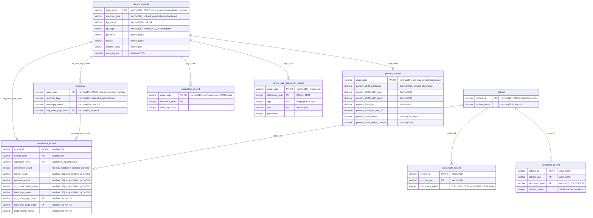

# Entity-relationship diagram

The business entities the project tracks and how they relate. This is a logical view, not the Gold table layout: Gold is a galaxy schema, documented separately in the [data model](data-model.md). The entities follow the team's alignment decisions in #45.

The team edits the diagram on [dbdiagram.io](https://dbdiagram.io/d/ReachED-ERD-6acf49c2aebfe7a21fe5f61c); [`erd.dbml`](erd.dbml) is a copy of its code. The diagram below is the same model in Mermaid so GitHub renders it. Change both in the same pull request.

Every school-year row points to a city or municipality and a barangay, a real one or an explicit `unknown` or `excluded` member, so no row is lost in a join.

## Entities

| Entity | One row per | Key | Source or derivation |
|---|---|---|---|
| `city_municipality` | city or municipality, plus the `unknown` and `excluded` members | `psgc_code` | `psa_psgc` Silver ([D-035](../governance/decisions.md#d-035-psgc-silver)); members added in Integration |
| `barangay` | barangay, plus one `unknown` barangay per city or municipality | `psgc_code` | `psa_psgc` Silver ([D-035](../governance/decisions.md#d-035-psgc-silver)); members added in Integration |
| `school` | school | `school_id` | DepEd Silver |
| `enrollment_record` | school, school year, and education level | `school_id`, `school_year`, `education_level` | `deped_enrollment` Silver; the location columns from the Integration crosswalk ([D-029](../governance/decisions.md#d-029-one-set-of-match-columns-for-every-crosswalk), [D-031](../governance/decisions.md#d-031-special-geographic-area-schools-at-city-or-municipality-level), #91) |
| `classroom_record` | school and school year | `school_id`, `school_year` | `deped_facilities` Silver ([D-038](../governance/decisions.md#d-038-deped-facilities-silver)) |
| `personnel_record` | school, school year, and education level | `school_id`, `school_year`, `education_level` | `deped_personnel` Silver ([D-041](../governance/decisions.md#d-041-deped-personnel-silver)) |
| `population_record` | city or municipality and reference year | `psgc_code`, `reference_year` | PSGC's `2024 Population` column, `psa_psgc` Silver ([D-033](../governance/decisions.md#d-033-barangay-population-source)) |
| `school_age_population_record` | city or municipality, reference year, single year of age, and sex | `psgc_code`, `reference_year`, `age`, `sex` | **Provisional.** PSA Total Population by Single-Year Age, Sex, and City/Municipality, 2020 CPH and 2024 POPCEN ([source](../business/dataset-use-map.md#school-age-population-source)). Found, not yet profiled or ingested; names only, so it needs a name match to PSGC like [D-029](../governance/decisions.md#d-029-one-set-of-match-columns-for-every-crosswalk) |
| `poverty_record` | city or municipality (2023 only) | `psgc_code` | `psa_poverty_stat` Silver ([D-034](../governance/decisions.md#d-034-psa-poverty-stat-silver-unpivot-to-one-row-per-unit-and-estimate-year)), following D-046 (#151) |

## Definitions

- **Education levels** ([D-047](../governance/decisions.md#d-047-question-v1-metric-counting-rules)): ES is Kindergarten, Grades 1–6, and ES non-graded; JHS is Grades 7–10 and JHS non-graded; SHS is Grades 11–12. `education_level` holds only these three values, never grades or strands, so it is never NULL.
- **`classroom_count`**: the sum of the ES, JHS, and SHS instructional room counts that are not blank. NULL only when all three are blank.
- **`teacher_count`**: Teacher I–III, Master Teacher I–IV, Head Teacher I–VI, SPED/SNED teachers, Special Science teachers, Instructors, and locally funded teachers, counted by level (Kindergarten locally funded teachers under ES). Principals and all non-teaching staff are excluded (D-047).
- **Poverty** (D-046): one row per city or municipality for 2023, with `poverty_2023_status` `estimated`, `no_estimate`, or `not_in_source`. A row that is not `estimated` keeps every value NULL, never 0. Context only: never used to rank, flag, or score.

## Modeling assumptions

- **Location is stored per school year.** A school's city or municipality can change between school years, and AP4 compares years, so the PSGC codes, the match status, and DepEd's place names are on `enrollment_record`, not on `school`. They are the same for every education level of a school in a school year.
- **DepEd has no PSGC code.** The codes come from the Integration crosswalk ([D-029](../governance/decisions.md#d-029-one-set-of-match-columns-for-every-crosswalk), #91).
- **Unmatched schools point to explicit members, never NULL.** A school whose city or municipality is not matched points to the `unknown` city or municipality; a Special Geographic Area school points to `excluded` at city level ([D-031](../governance/decisions.md#d-031-special-geographic-area-schools-at-city-or-municipality-level)). A school that matched its city or municipality but not its barangay points to that city's `unknown` barangay, so it still rolls up to the right city. `psgc_match_status` keeps the reason.
- **Population is city/municipality level**, because AP1 ranks cities and municipalities.
- **Every PSGC city or municipality has a poverty row** (D-046), so the link is one-to-one for real cities and absent only for the `unknown` and `excluded` members.

## Resolved questions

Answered from the team's decisions (#45):

1. **Year alignment.** Gold has a school-year dimension. PSA tables keep their own reference year, and the pairing (D-027 for poverty; the two census points for AP4, 2020 with SY 2020-21 and 2024 with SY 2024-25) is done in Analytics.
2. **School-age population.** AP4 uses ages 5–17 at city or municipality level, from the 2020 and 2024 PSA tables.
3. **Missing counts.** Missing classroom and teacher counts show as missing, never zero ([D-023](../governance/decisions.md#d-023-silver-never-invents-a-value)).